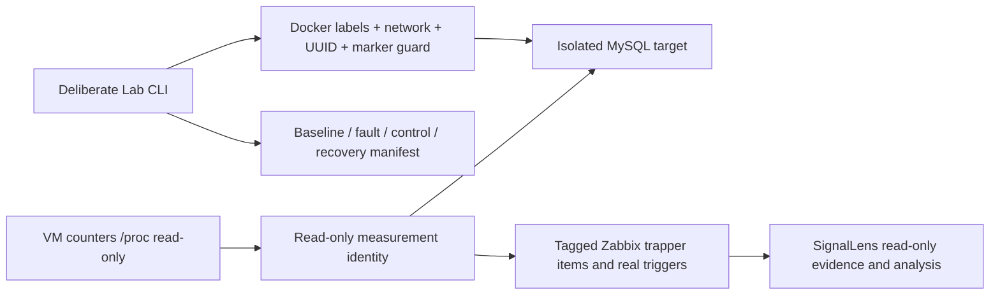

# SignalLens Lab

Independent real MySQL test system for a personal DBA operations portfolio. The orders dataset is deterministic synthetic business data; all telemetry, fault symptoms and Zabbix events are real measurements (`live_lab`). No production deployment or business improvement is claimed.

MySQL8.4.13 runs on an internal Docker network, separate from Zabbix's control database. Python3.12.10 probe reads MySQL status/lock waits/digests, the VM's read-only `/proc` CPU/disk counters and an authenticated connection plus `SELECT 1` roundtrip. Host CPU is aggregate VM CPU; probe latency includes connection/authentication/SQL, so neither measures a pure MySQL-container CPU or pure network RTT. No network fault is injected or claimed.



## Measured cases, 2026-11-08 UTC

These are archived real measurements on a dedicated personal Lab VM. Re-run values will vary. Sanitized case files preserve observations and errors, without private target identity or credentials.

| Case | Observed evidence | Recovery/cleanup | Artifact |
| --- | --- | --- | --- |
| Lock wait,10:47:09–10:48:04 | Actual wait count1, repeated MySQL1205 timeouts; independent SELECT1 succeeded while wait count stayed1 | Rollback; waits0; scenario sessions0; dataset unchanged | [Lock case](docs/cases/lock-wait.json) |
| SQL load,10:49:12–10:50:03 | Two BENCHMARK workers; max threads_running4; fault VM CPU mean38.721%, baseline mean1.261%; observed fault mean19.459qps | Workers stopped; sessions0; waits0; dataset unchanged | [SQL case](docs/cases/sql-load.json) |
| SIGTERM during lock fault,10:50:42–10:51:12 | Real interruption retained as failed_or_insufficient, actual waits observed before termination | Workers stopped; sessions0; waits0; dataset unchanged | [Termination case](docs/cases/termination.json) |
| Collector gap,10:51:33–10:51:48 | Probe paused15s; actual Zabbix history has no samples strictly inside that interval | Probe resumed3s cadence; target kept running | [Gap check](docs/cases/collector-gap.json) |

Zabbix recorded real problem/recovery pairs: lock24→26 and28→30; SQL-load32→33. Timeout retries can briefly remove a lock waiter and cause event flapping. The SQL activity trigger measures `threads_running>2`, which can also occur during a lock case; it is a symptom, not a unique diagnosis.

QPS includes collector queries. The original runs collected first recovery immediately after the independent SELECT1 control, creating a very short denominator and a189.49qps spike outside the fault window. Raw evidence is preserved; this is sampling overhead, not claimed fault throughput or improvement. Current code waits3s before recovery sampling. VM CPU also includes other services; the means are observations, not an isolated causal benchmark.

## Setup on the dedicated VM

Use `/opt/signallens-lab`, Docker Compose and an existing external `signallens-internal` network with Zabbix7.0.32 at `zabbix-server:10051`. The target has no host ports. Probe runs UID/GID1000 with all capabilities dropped, read-only root filesystem and no Docker socket. Match ownership of `.runtime` to UID1000.

Private `.runtime/private/root_password` and `target.json` must be generated locally outside source control. Target config schema:

```json
{"container":"signallens-lab-target","owner":"signallens-lab","role":"target","database":"lab_orders","marker":"signallens-lab-v1","passwords":{"monitor":"GENERATE","scenario":"GENERATE"}}
```

`python -m lab.cli init` records actual `server_uuid` in this private file after seeding 10,000 orders. Root credentials are used only during initialization. Monitor has SELECT on Lab/performance_schema plus PROCESS; scenario has SELECT/UPDATE on orders only. Before injection the launcher verifies actual Docker labels, name and dedicated network; harness checks pinned endpoint, UUID and identity marker. Unknown UUID, marker or target labels are rejected. The scenario identity cannot access the Zabbix database.

Download Linux wheels to ignored `vendor/` on a networked machine; dependencies are fully pinned in `requirements.txt`. Transfer source/wheels/private config via pinned SSH. Build installs offline:

```sh
python -m pip download --dest vendor --platform manylinux_2_28_x86_64 --platform manylinux2014_x86_64 --platform manylinux_2_17_x86_64 --python-version 312 --implementation cp --abi cp312 --only-binary=:all: -r requirements.txt
```

Then on the dedicated VM, as UID1000, from `/opt/signallens-lab`:

```sh
docker compose build probe
python3 setup_private.py
docker compose up -d target
docker compose run --rm -v /opt/signallens-lab/.runtime/private/root_password:/run/secrets/lab-root-password:ro probe python -m lab.cli init
```

Admin-only Zabbix seed is a separate one-shot bootstrap. From the VM with local Python, run `lab.bootstrap.bootstrap(url, private_admin_password_file, groupid='22')`; it creates only allowlisted Lab hosts/items/triggers. The formal backend keeps a separate read-only token. Seed output is `.runtime/seed.json`, no admin token is persisted. Current source ID is `lab`, datasource UID `signallens-zabbix`. Host/item semantics are in `lab/metrics.py`; item tags are explicit `sl.metric`/`sl.kind`, hosts `sl.layer`/`sl.system`/`sl.parent`. Provenance text is actual measurement metadata, not an invented server log.

```sh
python3 -m lab.bootstrap --url http://ZABBIX_VM:8080/api_jsonrpc.php --password-file /path/outside/source/zabbix_admin_password --group-id 22
```

Replace the URL/password-file path with the separately provisioned private deployment settings. Admin credentials are used by this bootstrap on the VM host; they are not mounted into the long-running probe. The nominal cadence tag is `sl.sample_period=3s`; scenario snapshots can add denser observations.

```sh
docker compose up -d probe
python3 run_scenario.py lock_wait --duration 25
python3 run_scenario.py sql_load --duration 25
```

Run one scenario at a time. Lock case holds a single-row update, retries blocked updates with a 6s server lock timeout, and rolls everything back. SQL case uses two connections with bounded BENCHMARK queries and a 2s server execution cap. Allowed fault duration10..45s. SIGINT/SIGTERM invokes finally cleanup; abrupt OS/process loss relies on connection closure and MySQL timeout, so that event cannot promise a complete manifest. Every ordinary run records UTC phases, observations, actual errors, negative `SELECT 1` control, connection/workload cleanup and before/after dataset checks. Recovery requires actual zero waits and no remaining scenario sessions; a successful `SELECT 1` alone does not establish recovery. Failed/insufficient cases remain visible.

The collector writes `.runtime/samples/observations.jsonl` every3s and requires Zabbix sender `failed: 0`; errors remain recorded. Initial/reset/gap rate data is missing, never zero-filled. CPU/disk/query rates use monotonic-time deltas. SQL digest counters are cumulative since server startup, not interval summaries.

## Verification and operations

```sh
python -m unittest discover -s tests -v
docker compose ps
docker compose logs --tail 10 probe
docker compose stop probe target
```

Stop preserves the dataset volume. Do not remove volumes during an evidence run. Runtime manifests, samples, private credentials and logs are ignored and should be reviewed before any publication. Current real evidence and commands are summarized in ignored `.runtime/lab-report.md` and `CHECKPOINT.txt`.

The archived first runs used row count, amount sum and CRC32 XOR dataset checks. Current runs additionally compare SHA256 of canonical rows ordered by primary key. Historical artifacts retain their original check fields.

This project does not include AI credentials or a model executor. SignalLens reads Zabbix using its separate read-only integration and owns the evidence/rule/model analysis acceptance.
