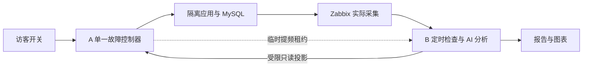
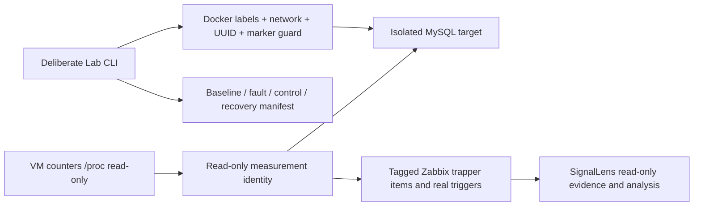

# SignalLens Lab

**开启一个真实、可关闭的问题，观察 AI 数据库运维平台如何发现、分析和恢复。**

本项目是 [DB Evidence Platform](https://github.com/catdogrennie-gt/db-evidence-platform) 的独立验证与快速演示环境：用有限的业务请求和隔离 MySQL 复现问题，让平台根据真实 Zabbix 数据自主检查，逐项验证能力与不足。它不把故障名称或预期答案发送给模型，也不代表生产部署效果。

## 在线体验

| 入口 | 用途 | 登录 |
| --- | --- | --- |
| **[A · 快速功能演示](https://representatives-remedies-eva-effectively.trycloudflare.com)** | 选择场景、打开/关闭故障，同页看实际观测与分析结果 | 无需登录 |
| **[B · 完整分析平台](https://screens-sponsor-kijiji-julie.trycloudflare.com)** | 查看监控、问题、冻结报告及安全配置概览 | `demo` / `EvidenceDemo-2026!` |

B 的公开账号可以查看获授权范围内的安全信息，不能修改配置、启动分析或执行数据库操作；原始敏感资料不因公开演示而放开。两个网址是临时隧道，依赖演示电脑在线；公开密码仅属于此部署的只读身份，不是新安装的默认口令。

<details>
<summary>展开快速演示操作</summary>

1. 在 A 选择一个场景，先看业务现象、当时的 Zabbix 告警对照和联合分析线索。
2. 打开唯一故障开关。所有访客共享一次真实实验，重复开启不会叠加负载；仅浏览其他场景不会改变公共开关。
3. 同页看实际采样、平台自主检查和新报告，也可进入 B 核对图表与证据。页面每 60 秒刷新，保留展开与阅读位置；“刷新数据”只读刷新，不会创建分析任务。
4. 关闭开关后，分别确认负载已清理、随后监控数据恢复。关闭网页不等于关闭故障；清理成功也不等于新采样已证明恢复。

A 只制造固定、有界的故障并临时借用 B 的较快检查周期，**不直接创建报告或调用模型**。Zabbix 保存实际数据，B 的普通巡检和分析队列决定何时发现与分析。模型失败、缺少资料和旧报告都按实际状态显示，不生成替代结论。

</details>

## 当前验证进度

新环境包含 **4 个 MySQL、3 个业务应用、6 个场景**。下面分别记录工作流与解释质量；有报告不等于根因已经确认。

| 场景 | 当前实际状态 |
| --- | --- |
| SQL 效率退化 | 自主发现、新报告与恢复已验证；具体 SQL、执行计划和因果引用仍需完善 |
| 应用连接池紧张 | 自主发现、池等待/错误关联与恢复已验证；模型输入遗漏池容量及 DB 上限，深层诊断待完善 |
| 临时表查询代价 | 自主发现、新报告与恢复已验证；本轮 AI 尚未定位临时表机制 |
| 应用排队反证、长读事务、副本读陈旧 | 固定负载、直接观测与清理已验证；完整平台闭环仍待逐项验证 |

前三项是 **2026-11-12 隔离环境的单次工作流实测**，不是通用准确率或生产收益证明。Zabbix 可以配置更细的规则；本项目对照的是当时真实模板、阈值、持续时间及事件，区分未配置、未触发和已有告警。

实际数据与解释缺口见 **[验证记录与分析边界](docs/validation/observed-analysis-boundaries.md)**；平台后续清单见 **[验证与改进](https://github.com/catdogrennie-gt/db-evidence-platform/blob/main/docs/validation-scenarios.md)**。历史测量没有完整记录每个 worker 的构建与提示词版本时，保留该追溯限制，不补写未记录的版本。

## 如何组成



- `compose.evolution.yaml` / `compose.replica.yaml`：四库三应用，限制内存、CPU、连接与测试数据规模；与原公开单场景环境分开。
- `lab/business_app.py` / `replica_app.py`：有限业务请求、数据库查询和中性采样端点，不输出故障答案。
- `lab/scenario_engine.py` / `scenario_site.py` / `lab/web-v2`：单一所有者、共享开关、有限租约、只读观测与演示页面。
- `lab/scenario_validation.py` / `tools/validate-scenario.py`：逐项验证正常、故障、直接清理、监控恢复和本次报告，不把完成状态当作诊断正确。

A 调用 B 的受限接口，B 独立拥有采集、检查与分析。网页不接收任意数据库地址、SQL、命令或模型提示词；私密配置和服务凭据保留在源码外。

## 如何部署与验证

需要 Linux Docker / Compose、独立 Zabbix、已经启动的 B，以及仓库外显式私密配置。**不要直接对现有业务数据库或原演示容器运行初始化步骤。**

按 **[多场景环境与重建指南](docs/evolution-lab.md)** 准备隔离目标、官方 MySQL 模板和扩展采集，再启动新 A。该指南包含资源上限、连接权限、采样周期、复制重建、验收 CLI 和恢复语义；平台接入与日常操作见 **[B 操作手册](https://github.com/catdogrennie-gt/db-evidence-platform/blob/main/docs/operator-manual.md)**。

本轮官方状态主项实验频率为 10 秒、扩展项为 5 秒，仍需核对实际样本时间；生产环境应重新评估采集成本。A 是单控制器，不能对同一目标并行启动蓝、绿两个 owner。B 可独立准备新 API 并切换固定网关；A 控制器升级需在明确释放负载后进行。

仓库内自动测试使用固定数据与替身，不等于真实全链路效果；实际结果以验证记录为准。

```sh
python -m unittest discover -s tests -v
node --test tests/web.test.mjs
```

<details>
<summary>历史固定锁等待站、CLI 实验与原始部署说明</summary>

以下保留旧版实验记录，**其中的目标、周期和命令不描述上方当前多场景站**。旧公网入口暂保留在线用于查阅；请从上方新链接体验本轮系统。

## 历史命令行 Lab 与实测案例

以下是原有独立 CLI 实验及归档测量，保留其当时的采集方式、时长限制、错误与结果。**这些 CLI 的 10–45 秒时长、旧采集周期与旧验收不描述上方当前 A 网站开关。** 当前网站复用隔离实验边界，但业务监控与 AI 结果由 B 普通 Zabbix 巡检拥有。
Independent real MySQL test system for a personal DBA operations portfolio. The orders dataset is deterministic synthetic business data; all telemetry, fault symptoms and Zabbix events are real measurements (`live_lab`). No production deployment or business improvement is claimed.

MySQL8.4.13 runs on an internal Docker network, separate from Zabbix's control database. Python3.12.10 probe reads MySQL status/lock waits/digests, the VM's read-only `/proc` CPU/disk counters and an authenticated connection plus `SELECT 1` roundtrip. Host CPU is aggregate VM CPU; probe latency includes connection/authentication/SQL, so neither measures a pure MySQL-container CPU or pure network RTT. No network fault is injected or claimed.



## Measured cases, 2026-11-08 UTC

These are archived real measurements on a dedicated personal Lab VM. Re-run values will vary. Sanitized case files preserve observations and errors, without private target identity or credentials.

| Case | Observed evidence | Recovery/cleanup | Artifact |
| --- | --- | --- | --- |
| Lock wait,10:47:09–10:48:04 | Actual wait count1, repeated MySQL1205 timeouts; independent SELECT1 succeeded while wait count stayed1 | Rollback; waits0; scenario sessions0; dataset unchanged | [Lock case](docs/cases/lock-wait.json) |
| SQL load,10:49:12–10:50:03 | Two BENCHMARK workers; max threads_running4; fault VM CPU mean38.721%, baseline mean1.261%; observed fault mean19.459qps | Workers stopped; sessions0; waits0; dataset unchanged | [SQL case](docs/cases/sql-load.json) |
| SIGTERM during lock fault,10:50:42–10:51:12 | Real interruption retained as failed_or_insufficient, actual waits observed before termination | Workers stopped; sessions0; waits0; dataset unchanged | [Termination case](docs/cases/termination.json) |
| Collector gap,10:51:33–10:51:48 | Probe paused15s; actual Zabbix history has no samples strictly inside that interval | Probe resumed3s cadence; target kept running | [Gap check](docs/cases/collector-gap.json) |

Zabbix recorded real problem/recovery pairs: lock24→26 and28→30; SQL-load32→33. Timeout retries can briefly remove a lock waiter and cause event flapping. The SQL activity trigger measures `threads_running>2`, which can also occur during a lock case; it is a symptom, not a unique diagnosis.

QPS includes collector queries. The original runs collected first recovery immediately after the independent SELECT1 control, creating a very short denominator and a189.49qps spike outside the fault window. Raw evidence is preserved; this is sampling overhead, not claimed fault throughput or improvement. Current code waits3s before recovery sampling. VM CPU also includes other services; the means are observations, not an isolated causal benchmark.

## Setup on the dedicated VM

Use `/opt/signallens-lab`, Docker Compose and an existing external `signallens-internal` network with Zabbix7.0.32 at `zabbix-server:10051`. The target has no host ports. Probe runs UID/GID1000 with all capabilities dropped, read-only root filesystem and no Docker socket. Match ownership of `.runtime` to UID1000.

Private `.runtime/private/root_password` and `target.json` must be generated locally outside source control. Target config schema:

```json
{"container":"signallens-lab-target","owner":"signallens-lab","role":"target","database":"lab_orders","marker":"signallens-lab-v1","passwords":{"monitor":"GENERATE","scenario":"GENERATE"}}
```

`python -m lab.cli init` records actual `server_uuid` in this private file after seeding 10,000 orders. Root credentials are used only during initialization. Monitor has SELECT on Lab/performance_schema plus PROCESS; scenario has SELECT/UPDATE on orders only. Before injection the launcher verifies actual Docker labels, name and dedicated network; harness checks pinned endpoint, UUID and identity marker. Unknown UUID, marker or target labels are rejected. The scenario identity cannot access the Zabbix database.

Download Linux wheels to ignored `vendor/` on a networked machine; dependencies are fully pinned in `requirements.txt`. Transfer source/wheels/private config via pinned SSH. Build installs offline:

```sh
python -m pip download --dest vendor --platform manylinux_2_28_x86_64 --platform manylinux2014_x86_64 --platform manylinux_2_17_x86_64 --python-version 312 --implementation cp --abi cp312 --only-binary=:all: -r requirements.txt
```

Then on the dedicated VM, as UID1000, from `/opt/signallens-lab`:

```sh
docker compose build probe
python3 setup_private.py
docker compose up -d target
docker compose run --rm -v /opt/signallens-lab/.runtime/private/root_password:/run/secrets/lab-root-password:ro probe python -m lab.cli init
```

Admin-only Zabbix seed is a separate one-shot bootstrap. From the VM with local Python, run `lab.bootstrap.bootstrap(url, private_admin_password_file, groupid='22')`; it creates only allowlisted Lab hosts/items/triggers. The formal backend keeps a separate read-only token. Seed output is `.runtime/seed.json`, no admin token is persisted. Current source ID is `lab`, datasource UID `signallens-zabbix`. Host/item semantics are in `lab/metrics.py`; item tags are explicit `sl.metric`/`sl.kind`, hosts `sl.layer`/`sl.system`/`sl.parent`. Provenance text is actual measurement metadata, not an invented server log.

```sh
python3 -m lab.bootstrap --url http://ZABBIX_VM:8080/api_jsonrpc.php --password-file /path/outside/source/zabbix_admin_password --group-id 22
```

Replace the URL/password-file path with the separately provisioned private deployment settings. Admin credentials are used by this bootstrap on the VM host; they are not mounted into the long-running probe. The nominal cadence tag is `sl.sample_period=3s`; scenario snapshots can add denser observations.

```sh
docker compose up -d probe
python3 run_scenario.py lock_wait --duration 25
python3 run_scenario.py sql_load --duration 25
```

Run one scenario at a time. Lock case holds a single-row update, retries blocked updates with a 6s server lock timeout, and rolls everything back. SQL case uses two connections with bounded BENCHMARK queries and a 2s server execution cap. Allowed fault duration10..45s. SIGINT/SIGTERM invokes finally cleanup; abrupt OS/process loss relies on connection closure and MySQL timeout, so that event cannot promise a complete manifest. Every ordinary run records UTC phases, observations, actual errors, negative `SELECT 1` control, connection/workload cleanup and before/after dataset checks. Recovery requires actual zero waits and no remaining scenario sessions; a successful `SELECT 1` alone does not establish recovery. Failed/insufficient cases remain visible.

The collector writes `.runtime/samples/observations.jsonl` every3s and requires Zabbix sender `failed: 0`; errors remain recorded. Initial/reset/gap rate data is missing, never zero-filled. CPU/disk/query rates use monotonic-time deltas. SQL digest counters are cumulative since server startup, not interval summaries.

### SQL snapshot field-unit contract

The text item `sl.mysql.sql_summary` carries trusted Zabbix item tags `sl.field_unit.SUM_TIMER_WAIT=ps`, `sl.field_unit.MAX_TIMER_WAIT=ps`, and `sl.snapshot_scope=server_lifetime`. These describe nested Performance Schema fields; the text item's own units remain empty. The collector currently selects those two timer fields, and both are explicitly tagged. `ps` means picoseconds: divide by **1,000,000,000,000** to obtain seconds. `MAX_TIMER_WAIT` is the longest recorded statement duration; `SUM_TIMER_WAIT` is accumulated duration over `COUNT_STAR` statements. Neither is milliseconds, seconds, or a duration confined to the selected dashboard window.

The JSON payload also says `timer_unit: picoseconds` and `cumulative_since_server_start: true`. The scope describes cumulative server instrumentation, which can reset on server restart or deliberate Performance Schema reset; a snapshot timestamp marks collection, not the start time of every summarized SQL statement. Consumers should use the trusted item field metadata when interpreting raw numbers and disclose the cumulative scope. Historical JSON case files remain unchanged.

The real Lab UPDATE digest provided a useful unit check: `MAX_TIMER_WAIT=6001931921000 ps` converts to **6.001931921 seconds**. Its `SUM_TIMER_WAIT=36008702663000 ps` converts to 36.008702663 accumulated seconds over 8 statements; that sum is not the duration of one execution. This caught an actual model interpretation error and motivated explicit field metadata in addition to the raw JSON's unit label.

## Verification and operations

```sh
python -m unittest discover -s tests -v
docker compose ps
docker compose logs --tail 10 probe
docker compose stop probe target
```

Stop preserves the dataset volume. Do not remove volumes during an evidence run. Runtime manifests, samples, private credentials and logs are ignored and should be reviewed before any publication. Current real evidence and commands are summarized in ignored `.runtime/lab-report.md` and `CHECKPOINT.txt`.

The archived first runs used row count, amount sum and CRC32 XOR dataset checks. Current runs additionally compare SHA256 of canonical rows ordered by primary key. Historical artifacts retain their original check fields.

This project does not include AI credentials or a model executor. SignalLens reads Zabbix using its separate read-only integration and owns the evidence/rule/model analysis acceptance.

</details>
