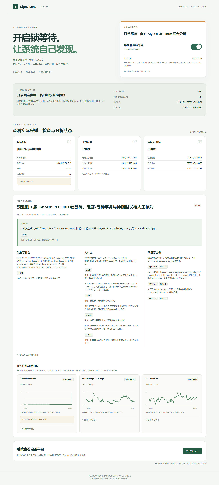
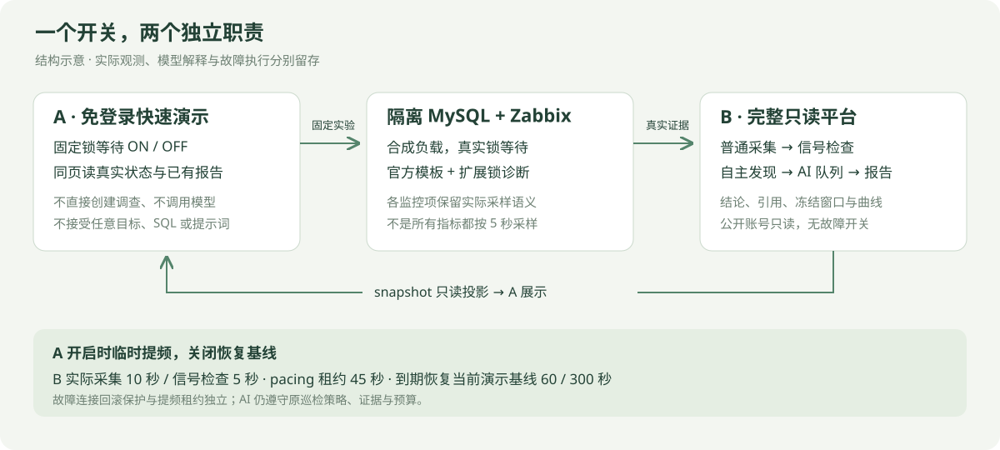
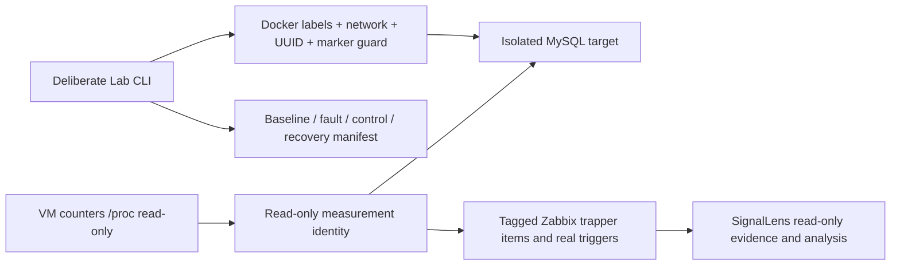

# SignalLens Lab

**免登录开启一个真实问题，看完整运维平台自己发现与解释。**

| 入口 | 直接访问 | 账号 |
| --- | --- | --- |
| **A · 快速功能演示（本仓库）** | **[打开固定锁等待演示](https://rural-surrounding-obviously-wellness.trycloudflare.com)** | **无需登录** |
| **B · 完整运维平台** | **[打开完整只读平台](https://deliver-doubt-epson-document.trycloudflare.com)** | **`demo` / `EvidenceDemo-2026!`** |

A 是一个轻量独立网站：固定锁等待开关、真实故障状态，以及 B 的实际采样、信号检查、AI 任务、报告三问摘要和最多三条冻结曲线。B 的源码见 [DB Evidence Platform](https://github.com/catdogrennie-gt/db-evidence-platform)，保留原有完整系统；公开账号只有固定对象的 `data.read`、`event.read`、`knowledge.read` 权限。



上图是本轮真实实验截图：B 普通巡检自行发现并生成报告，A 展示其结果；未向图表插入模拟点。正常关闭和控制进程异常退出后的清理与周期恢复均已实际核验；另一次模型非法 JSON 失败记录也保留，详见[完整验收记录](https://github.com/catdogrennie-gt/db-evidence-platform/blob/main/docs/acceptance-quick-showcase.md)。两个地址均为临时隧道，依赖演示电脑与服务在线，可能变化。公开密码仅用于此部署的只读演示身份，不是新安装的默认密码。



## 试用方法

1. 打开 A，无需登录。所有访客共享同一个固定隔离 MySQL 实验开关。
2. 开启开关，持续制造测试行的锁等待。没有次数、冷却、固定运行时长或等待 Zabbix 恢复才能再开的门槛；重复开启不应累加故障连接。
3. 看 B 的实际观测、发现和 AI 任务阶段，再读“发生了什么、为什么、现在怎么做”。A 不创建调查、不调用模型，只展示 B 受限接口中的真实结果；旧报告明确标为历史。
4. 关闭开关，请求回滚并恢复正常周期。关闭网页不等于关闭实验；控制服务失联后依赖短租约回滚保护，清理结果仍需实际核验。
5. 进入 B 根地址，用只读账号查看完整对象、数据、证据与历史报告；B 没有故障开关。

A 开启时租用 B 的临时周期：实际读取 Zabbix 数据 **10 秒**、信号检查 **5 秒**，关闭或 **45 秒租约**失效后恢复当前演示基线 **60 / 300 秒**。AI 仍由 B 普通巡检、异常发现和队列自主决定；提频不等于每 5 秒调用模型。官方模板各 item 采样频率不同，本轮仅扩展锁诊断快照设为 5 秒，不声称全部监控指标都是 5 秒。

实际观测、采集时间、任务阶段与冻结报告分别显示。缺失不补零、旧值不代表当前健康；结构快照与数值曲线可能来自不同监控项和时刻，数值曲线没有故障点不否定结构快照中的锁等待。失败、证据不足与预算不足不生成替代结论。

操作、周期、接口与失败语义见 **[快速演示指南](docs/quick-showcase.md)**。浏览器只调用 A 同源状态 / 开关接口；B 私密服务 token 和固定目标配置始终留在服务端与公开源码外，不向浏览器提供任意目标、SQL、命令或提示词。

## 当前网站源码与验证

- `lab/web/`：原生 HTML / CSS / JavaScript 页面与实际有限样本 SVG 图，不需要第三套分析系统或前端构建依赖。
- `lab/toggle_web.py`、`lab/toggle_controller.py`、`lab/toggle_target.py`：固定开关 API、串行 controller、受守卫的事务负载与 B 只读投影 / 临时提频桥接。
- `tests/web.test.mjs`：页面契约、真实点与缺口、过期快照、历史报告和安全转义测试。

```sh
node --test tests/web.test.mjs
node --check lab/web/app.js
python -m unittest discover -s tests -v
```

启动依赖仓库外显式私密目标、身份守卫与 B 服务接口配置；公开仓库不提供可直接运行到任意数据库的默认凭据。

## 历史命令行 Lab 与实测案例

以下是原有独立 CLI 实验及归档测量，保留其当时的采集方式、时长限制、错误与结果。**这些 CLI 的 10–45 秒时长、旧采集周期与旧验收不描述上方当前 A 网站开关。** 当前网站复用隔离实验边界，但业务监控与 AI 结果由 B 普通 Zabbix 巡检拥有。
Independent real MySQL test system for a personal DBA operations portfolio. The orders dataset is deterministic synthetic business data; all telemetry, fault symptoms and Zabbix events are real measurements (`live_lab`). No production deployment or business improvement is claimed.

MySQL8.4.13 runs on an internal Docker network, separate from Zabbix's control database. Python3.12.10 probe reads MySQL status/lock waits/digests, the VM's read-only `/proc` CPU/disk counters and an authenticated connection plus `SELECT 1` roundtrip. Host CPU is aggregate VM CPU; probe latency includes connection/authentication/SQL, so neither measures a pure MySQL-container CPU or pure network RTT. No network fault is injected or claimed.



## Measured cases, 2026-11-08 UTC

These are archived real measurements on a dedicated personal Lab VM. Re-run values will vary. Sanitized case files preserve observations and errors, without private target identity or credentials.

| Case | Observed evidence | Recovery/cleanup | Artifact |
| --- | --- | --- | --- |
| Lock wait,10:47:09–10:48:04 | Actual wait count1, repeated MySQL1205 timeouts; independent SELECT1 succeeded while wait count stayed1 | Rollback; waits0; scenario sessions0; dataset unchanged | [Lock case](docs/cases/lock-wait.json) |
| SQL load,10:49:12–10:50:03 | Two BENCHMARK workers; max threads_running4; fault VM CPU mean38.721%, baseline mean1.261%; observed fault mean19.459qps | Workers stopped; sessions0; waits0; dataset unchanged | [SQL case](docs/cases/sql-load.json) |
| SIGTERM during lock fault,10:50:42–10:51:12 | Real interruption retained as failed_or_insufficient, actual waits observed before termination | Workers stopped; sessions0; waits0; dataset unchanged | [Termination case](docs/cases/termination.json) |
| Collector gap,10:51:33–10:51:48 | Probe paused15s; actual Zabbix history has no samples strictly inside that interval | Probe resumed3s cadence; target kept running | [Gap check](docs/cases/collector-gap.json) |

Zabbix recorded real problem/recovery pairs: lock24→26 and28→30; SQL-load32→33. Timeout retries can briefly remove a lock waiter and cause event flapping. The SQL activity trigger measures `threads_running>2`, which can also occur during a lock case; it is a symptom, not a unique diagnosis.

QPS includes collector queries. The original runs collected first recovery immediately after the independent SELECT1 control, creating a very short denominator and a189.49qps spike outside the fault window. Raw evidence is preserved; this is sampling overhead, not claimed fault throughput or improvement. Current code waits3s before recovery sampling. VM CPU also includes other services; the means are observations, not an isolated causal benchmark.

## Setup on the dedicated VM

Use `/opt/signallens-lab`, Docker Compose and an existing external `signallens-internal` network with Zabbix7.0.32 at `zabbix-server:10051`. The target has no host ports. Probe runs UID/GID1000 with all capabilities dropped, read-only root filesystem and no Docker socket. Match ownership of `.runtime` to UID1000.

Private `.runtime/private/root_password` and `target.json` must be generated locally outside source control. Target config schema:

```json
{"container":"signallens-lab-target","owner":"signallens-lab","role":"target","database":"lab_orders","marker":"signallens-lab-v1","passwords":{"monitor":"GENERATE","scenario":"GENERATE"}}
```

`python -m lab.cli init` records actual `server_uuid` in this private file after seeding 10,000 orders. Root credentials are used only during initialization. Monitor has SELECT on Lab/performance_schema plus PROCESS; scenario has SELECT/UPDATE on orders only. Before injection the launcher verifies actual Docker labels, name and dedicated network; harness checks pinned endpoint, UUID and identity marker. Unknown UUID, marker or target labels are rejected. The scenario identity cannot access the Zabbix database.

Download Linux wheels to ignored `vendor/` on a networked machine; dependencies are fully pinned in `requirements.txt`. Transfer source/wheels/private config via pinned SSH. Build installs offline:

```sh
python -m pip download --dest vendor --platform manylinux_2_28_x86_64 --platform manylinux2014_x86_64 --platform manylinux_2_17_x86_64 --python-version 312 --implementation cp --abi cp312 --only-binary=:all: -r requirements.txt
```

Then on the dedicated VM, as UID1000, from `/opt/signallens-lab`:

```sh
docker compose build probe
python3 setup_private.py
docker compose up -d target
docker compose run --rm -v /opt/signallens-lab/.runtime/private/root_password:/run/secrets/lab-root-password:ro probe python -m lab.cli init
```

Admin-only Zabbix seed is a separate one-shot bootstrap. From the VM with local Python, run `lab.bootstrap.bootstrap(url, private_admin_password_file, groupid='22')`; it creates only allowlisted Lab hosts/items/triggers. The formal backend keeps a separate read-only token. Seed output is `.runtime/seed.json`, no admin token is persisted. Current source ID is `lab`, datasource UID `signallens-zabbix`. Host/item semantics are in `lab/metrics.py`; item tags are explicit `sl.metric`/`sl.kind`, hosts `sl.layer`/`sl.system`/`sl.parent`. Provenance text is actual measurement metadata, not an invented server log.

```sh
python3 -m lab.bootstrap --url http://ZABBIX_VM:8080/api_jsonrpc.php --password-file /path/outside/source/zabbix_admin_password --group-id 22
```

Replace the URL/password-file path with the separately provisioned private deployment settings. Admin credentials are used by this bootstrap on the VM host; they are not mounted into the long-running probe. The nominal cadence tag is `sl.sample_period=3s`; scenario snapshots can add denser observations.

```sh
docker compose up -d probe
python3 run_scenario.py lock_wait --duration 25
python3 run_scenario.py sql_load --duration 25
```

Run one scenario at a time. Lock case holds a single-row update, retries blocked updates with a 6s server lock timeout, and rolls everything back. SQL case uses two connections with bounded BENCHMARK queries and a 2s server execution cap. Allowed fault duration10..45s. SIGINT/SIGTERM invokes finally cleanup; abrupt OS/process loss relies on connection closure and MySQL timeout, so that event cannot promise a complete manifest. Every ordinary run records UTC phases, observations, actual errors, negative `SELECT 1` control, connection/workload cleanup and before/after dataset checks. Recovery requires actual zero waits and no remaining scenario sessions; a successful `SELECT 1` alone does not establish recovery. Failed/insufficient cases remain visible.

The collector writes `.runtime/samples/observations.jsonl` every3s and requires Zabbix sender `failed: 0`; errors remain recorded. Initial/reset/gap rate data is missing, never zero-filled. CPU/disk/query rates use monotonic-time deltas. SQL digest counters are cumulative since server startup, not interval summaries.

### SQL snapshot field-unit contract

The text item `sl.mysql.sql_summary` carries trusted Zabbix item tags `sl.field_unit.SUM_TIMER_WAIT=ps`, `sl.field_unit.MAX_TIMER_WAIT=ps`, and `sl.snapshot_scope=server_lifetime`. These describe nested Performance Schema fields; the text item's own units remain empty. The collector currently selects those two timer fields, and both are explicitly tagged. `ps` means picoseconds: divide by **1,000,000,000,000** to obtain seconds. `MAX_TIMER_WAIT` is the longest recorded statement duration; `SUM_TIMER_WAIT` is accumulated duration over `COUNT_STAR` statements. Neither is milliseconds, seconds, or a duration confined to the selected dashboard window.

The JSON payload also says `timer_unit: picoseconds` and `cumulative_since_server_start: true`. The scope describes cumulative server instrumentation, which can reset on server restart or deliberate Performance Schema reset; a snapshot timestamp marks collection, not the start time of every summarized SQL statement. Consumers should use the trusted item field metadata when interpreting raw numbers and disclose the cumulative scope. Historical JSON case files remain unchanged.

The real Lab UPDATE digest provided a useful unit check: `MAX_TIMER_WAIT=6001931921000 ps` converts to **6.001931921 seconds**. Its `SUM_TIMER_WAIT=36008702663000 ps` converts to 36.008702663 accumulated seconds over 8 statements; that sum is not the duration of one execution. This caught an actual model interpretation error and motivated explicit field metadata in addition to the raw JSON's unit label.

## Verification and operations

```sh
python -m unittest discover -s tests -v
docker compose ps
docker compose logs --tail 10 probe
docker compose stop probe target
```

Stop preserves the dataset volume. Do not remove volumes during an evidence run. Runtime manifests, samples, private credentials and logs are ignored and should be reviewed before any publication. Current real evidence and commands are summarized in ignored `.runtime/lab-report.md` and `CHECKPOINT.txt`.

The archived first runs used row count, amount sum and CRC32 XOR dataset checks. Current runs additionally compare SHA256 of canonical rows ordered by primary key. Historical artifacts retain their original check fields.

This project does not include AI credentials or a model executor. SignalLens reads Zabbix using its separate read-only integration and owns the evidence/rule/model analysis acceptance.
