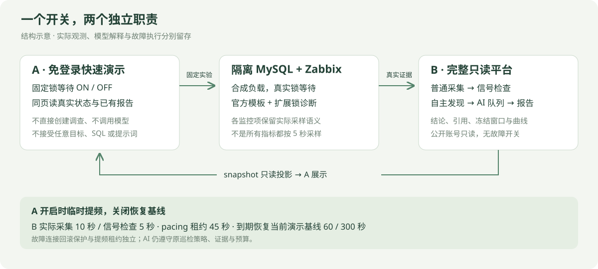

# 快速演示与完整平台

## 两个入口

| 入口 | 访问方式 | 用途 |
| --- | --- | --- |
| [A · 免登录快速演示](https://rural-surrounding-obviously-wellness.trycloudflare.com) | 无需账号 | 开启 / 关闭固定锁等待，同页查看 B 的真实观测、发现、AI 报告与冻结曲线 |
| [B · 完整运维平台](https://deliver-doubt-epson-document.trycloudflare.com) | 账号 **`demo`**，密码 **`EvidenceDemo-2026!`** | 只读查看问题分析、Zabbix 对象、数据和历史报告 |

两个地址均为临时隧道，依赖演示电脑与服务在线，可能变化，不承诺持续可用。公开密码只用于此部署的只读演示身份，新部署没有通用默认密码。该身份仅有 `data.read`、`event.read`、`knowledge.read` 及固定对象范围，不能修改配置、创建分析或执行故障。



上图是结构说明。实际截图见[README](../README.md)，完整成功、失败、正常关闭和进程异常退出记录见[B 的本轮验收](https://github.com/catdogrennie-gt/db-evidence-platform/blob/main/docs/acceptance-quick-showcase.md)；模型完成状态不等于根因正确。

## 操作顺序

1. 打开 A。无需登录，先看实际故障状态、B 最近实际采样、信号检查时间与 AI 任务阶段。
2. 开启开关，持续制造固定隔离 MySQL 测试行的锁等待。所有访客共享同一开关与实验。重复开启不应累加故障连接。
3. 等待 B 自己发现问题。A 不直接创建调查、不调用模型、不编写第三份分析；报告由 B 原有 Zabbix 采集、普通信号检查与 AI 队列形成。
4. 阅读报告的“发生了什么、为什么、现在怎么做”，再按需查看证据引用与最多三条实际冻结曲线。若显示历史 / 上次报告，该报告不代表新开启实验的结论；当前问题是否与报告关联由 B 的实际观测及冻结窗口判断。
5. 关闭开关，请求回滚固定实验事务并恢复正常周期。可直接再次开启，不要求先等到 Zabbix 恢复样本确认。故障实际状态、直接清理、监控恢复及历史报告分别看待。
6. 打开 B 根地址，以只读账号查看完整系统。B 没有故障开关，四个正常入口保留；只读账号不显示巡检修改入口。首页无显式时间参数时默认使用实时滚动窗口，显式时间选择及历史报告保留冻结范围。

A 的开关没有实验次数、冷却、固定运行时长或“监控已确认恢复才能再开”的门槛。开启后持续生效，关闭才请求回滚；关闭网页不等于关闭实验。目标、SQL 与连接身份固定，浏览器不能选择数据库、提交 SQL、命令或提示词。控制服务失联后由短租约保护回滚；这项保护不能替代实际清理核验。

## 周期与真实时间

| 层次 | 正常周期 | A 开启期间 | 恢复方式 |
| --- | --- | --- | --- |
| B 实际读取所选 Zabbix 数据 | 当前演示基线 60 秒 | 10 秒 | A 关闭释放提频，或 45 秒租约到期后由 B worker 恢复 |
| B 普通信号检查 | 当前演示基线 300 秒 | 5 秒 | 同上，不重置历史调用与报告 |
| 定期综合 AI | 按 B 原有策略与预算 | 不因开关变为每 5 秒调用 | 新异常仍走普通发现、去重和任务队列 |
| A 页面读取状态 | 3 秒 | 3 秒 | 展示读取到的真实记录，不生成进度百分比 |

上述 60 / 300 秒是当前演示部署基线，不是所有新安装的强制配置。提频只租用现有策略的实际采集与信号检查周期，关闭 / 到期恢复时不能覆盖管理员并发修改的新设置。页面显示实际周期、基线与租约状态；计划时间不是已执行的证据。

**B 读取周期和 Zabbix 上游采样周期不同。** 官方模板各 item 保留自己的采样 / 历史保存语义，并非全部 5 秒；本轮只将扩展锁诊断快照设置为 5 秒。加快 B 读取不会生成上游尚未采到的点。结构快照与数值曲线可能来自不同监控项、不同时间；曲线中没有故障点，不代表结构快照观察到的锁等待不存在。

## 两站接口与控制边界

- A 浏览器只调用同源 `GET /api/state` 与 `PUT /api/switch {"on":true|false}`。写入检查同源 Origin；故障 controller 串行落实最新期望状态，不累积通用故障任务。
- A 服务端以仓库外私密 token 调用 B 的 `GET /api/v1/showcase/snapshot` 与 `PUT /api/v1/showcase/pacing {"enabled":true|false}`。该能力只允许固定对象投影与临时周期租约，不能用于 B 一般业务 API。
- B snapshot 返回授权的当前锁观测、最近检查、真实任务阶段、已有报告与最多三条实际曲线。B 不依赖 A 的开关时间来编造异常或替报告贴“本轮完成”。
- 提频租约为 45 秒，A 正常运行时续期。A / 网络失联后，B worker 按租约恢复原周期；故障连接另有短租约与回滚保护，两种租约的职责不同。
- B 的采集、规则、AI 调查与冻结报告由原有 worker 和队列负责。模型没有任意 SQL、Shell、数据库写入或邮件工具。

## 如何读未知、失败和历史

缺失数据不补零，采样较早不等于健康。平台桥接卡住或读取失败时，A 保留最后快照并明确标为过期，显示最近成功接收时间；旧值不能说明当前健康或当前 AI 进展。

报告窗口、实际观察时间、采集时间及任务阶段分别显示。新任务排队或失败时可保留上一份真实报告，但必须标为历史。模型失败、预算不足、证据不足或未形成摘要时按原样显示，不以规则拼出新的模型结论。一次 `completed` 只说明该任务状态，不能单独证明根因正确或故障恢复。

这是个人隔离 Lab 的合成业务负载演示，实际观测、确定性判断与模型解释分别保留；不代表生产事故、生产采用或通用诊断准确率。旧的限次平台内演示和命令行案例作为历史材料保留，其时长、额度、截图及验收不用于描述当前 A 开关。

## 可复现启动（管理员，本地独立进程）

以下命令从 **SignalLens-Lab 仓库根目录**执行。`C:/example-private/`、`.example.invalid` 域名和 UUID 均为占位值，需要换成操作者已准备的私密配置；不包含真实目标、账号、SSH 凭据或服务 token。这些步骤启动 A，不会自动创建 MySQL 数据、Zabbix 监控项、B 联合对象或巡检策略。

### 1. 先准备 B 与固定实验目标

B 必须已有独立控制库和正在运行的 API、采集 worker、普通巡检 / AI worker，`collection_mode` 使用 **`zabbix_only`**。在 B 选择一个有效、启用、标记为 `is_lab` 的 Zabbix 联合对象，启用实际采集计划。普通巡检策略应已启用，且其对象范围恰好为这个固定 Lab；策略负责人按原平台权限、模型配置及外发许可运行真实 AI，与公开只读身份分开。展示桥配置不会自动创建这些资源或直接安排 AI。

为展示桥准备一个有效只读身份，仅授予 `data.read`、`event.read`、`knowledge.read`，精确到同一固定对象。记录该身份的 `reader_user_id`、对象 `instance_id` 及正常巡检 `policy_id`；这些必须是已有 B 数据中的真实 ID，不能照抄下方占位 UUID。

A 复用 B 原 `scripts/platform/prepare_demo.py` 准备流程**所关联的、已核对的私有 target 配置**，而不是 B 公开演示账号。该文件包括 `profile`、`ssh`、`scenario`、`monitor`、`expected_marker`、`baseline_sha256` 等连接与守卫资料，必须与当前容器、专用网络、MySQL UUID、标记及有序数据基线匹配。SSH known_hosts 也须为明确绝对私密路径。B 主配置、旧 CLI 的简化 `target.json` 都不能直接替代此文件。

旧 `prepare_demo.py` 要求 `--target-config` 指向**已经存在**的目标文件；它本身不生成此文件，而且会写入旧 `demo.enabled=true` 和旧演示权限。**不要为启动 A 直接重跑旧脚本或启用旧平台 Demo controller。** 迁移时先核对现有目标，保持 B 的 `demo.enabled=false`，将公开身份收敛为上述只读授权并撤销旧会话，再启用新的展示桥。B 公开页面不使用 `/demo`。

### 2. 生成独立私密长 token 并配置 B

服务 token 至少 32 个字符，应使用密码学随机长值，不使用公开账号密码、示例字符串或模型 API key。以下命令在仓库外生成 48 字节随机量的 URL-safe token，不向终端打印；路径同样是占位示例：

```powershell
python -c "import secrets; from pathlib import Path; p=Path(r'C:\example-private\SignalLensShowcase\bridge-token.txt'); p.parent.mkdir(parents=True, exist_ok=True); p.write_text(secrets.token_urlsafe(48), encoding='utf-8')"
```

在 B **已有的仓库外私密主配置**中合并下列片段，保留其他数据库、Zabbix、模型与应用设置。若 A / B 不在同一机器，安全传递相同 token 内容到两端私密文件，分别填写本机绝对路径。token 不写入 Git、URL、README、浏览器脚本或日志。

```json
{
  "collection_mode": "zabbix_only",
  "demo": { "enabled": false },
  "showcase": {
    "enabled": true,
    "instance_id": "11111111-1111-4111-8111-111111111111",
    "policy_id": "22222222-2222-4222-8222-222222222222",
    "reader_user_id": "33333333-3333-4333-8333-333333333333",
    "token_path": "C:/example-private/SignalLensShowcase/bridge-token.txt"
  }
}
```

按 B 原管理流程加载配置、启动服务，并核对普通监控和巡检本来就在工作。当前演示正常采集 / 信号基线为 60 / 300 秒；租约期间临时改为 10 / 5 秒。展示桥不会为未配置的普通巡检补建策略或模型身份。

### 3. 配置 A 的仓库外 JSON

在 `C:/example-private/SignalLensShowcase/showcase.json` 创建下列**占位示例**，替换目标文件和 token 路径。`LAB_SHOWCASE_CONFIG` 应明确指向这个仓库外主配置；`state_path`、`target_config_path`、`platform.token_path` 也都必须是仓库外绝对路径。

```json
{
  "public_origin": "http://127.0.0.1:18210",
  "allowed_origins": ["http://localhost:18210"],
  "state_path": "C:/example-private/SignalLensShowcase/switch.sqlite3",
  "target_config_path": "C:/example-private/SignalLensShowcase/target.private.json",
  "platform": {
    "api_url": "http://127.0.0.1:18080/api/v1/showcase",
    "token_path": "C:/example-private/SignalLensShowcase/bridge-token.txt",
    "public_url": "https://b-demo.example.invalid"
  }
}
```

`platform.api_url` 是 A 服务端访问的 B 地址，路径须为 `/api/v1/showcase`，不带查询串、片段或 URL 内嵌账号，不必等于浏览器使用的 B 地址。`platform.public_url` 仅用作页面“打开完整平台”链接，应填写 B 的公开**根地址**，不带 `from/to` 或其他查询。

`public_origin` 和 `allowed_origins` 是完整 `http(s)://主机[:端口]` Origin，不含业务路径、查询、片段或账号。A 写请求校验 Origin，Host 也仅允许这些 Origin 对应的主机。使用隧道时，将实际 A 公网 Origin 设为 `public_origin`，按需在 `allowed_origins` 加入本地 `http://127.0.0.1:18210`、`http://localhost:18210`；`https://a-demo.example.invalid` 只是域名占位，不是有效隧道。

### 4. 安装 Web 依赖并启动 A

```powershell
python -m venv .venv
.\.venv\Scripts\python.exe -m pip install -r requirements-web.txt
$env:LAB_SHOWCASE_CONFIG = 'C:\example-private\SignalLensShowcase\showcase.json'
.\.venv\Scripts\python.exe -m uvicorn lab.toggle_web:create_app --factory --host 127.0.0.1 --port 18210 --workers 1
```

`load_config()` 读取此环境变量，主配置必须先存在。仅使用**一个 worker**，不使用 `--reload`，不同时运行第二个故障 controller。A 状态库和独占锁文件位于仓库外配置的状态路径。启动后先访问 `http://127.0.0.1:18210/`，核对固定对象、实际故障状态、B 最近采样与租约信息，再有意操作开关。

`GET /api/health` 只证明 A 进程存活，不证明 B 连通、目标守卫通过、模型结论正确或恢复已验收。失败时核对页面稳定错误码及最近成功接收时间，不能将旧快照当当前状态。首次目标核对、真实 ON/OFF、数据不变、短租约回滚、B 周期恢复及自主发现 / AI 均需分别实测；上述命令不替代这些核验。
